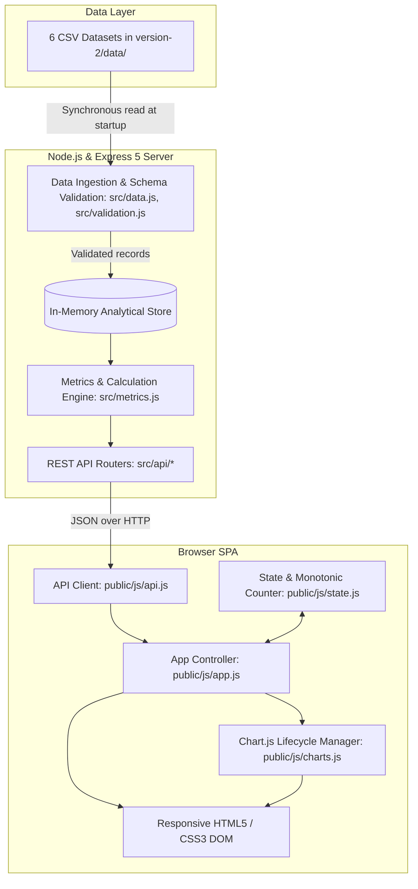

# Chennai MTC Transport Analytics — Version 2 Architecture

## 1. System Overview

Version 2 of the Chennai MTC Public Transport Analytics Dashboard is a decoupled web application designed for clarity, modularity, and high testability without unnecessary framework overhead. It replaces the Version 1 monolithic client-side D3.js architecture with a two-tier architecture:

1. **Backend Service:** A Node.js and Express.js 5 application providing in-memory CSV data management, analytical calculations, and RESTful JSON APIs.
2. **Frontend Client:** A responsive single-page application built with semantic HTML5, modern CSS3, vanilla JavaScript (ES modules), and Chart.js 4.4.7 for visual analytics.



---

## 2. Architectural Principles

- **Zero Database Overhead:** Datasets are relatively compact (672 trips, 2,688 observations). Loading and indexing them in memory at server startup provides sub-millisecond response times, zero database administration, and completely deterministic testing.
- **Strict Separation of Concerns:** Analytical arithmetic (aggregation, delay thresholds, headway variance, time-weighted occupancy) is strictly isolated in `src/metrics.js` and pure JavaScript functions, completely decoupled from HTTP handling.
- **Standardized REST Contract:** All analytical endpoints follow consistent URL patterns, query parameter conventions (`routeId`, `serviceDate`, `limit`), and standardized response envelopes (`{ success, data, meta }` or `{ success: false, error }`).
- **Standard-Compliant Client:** The frontend uses no external build tools, bundlers, or heavy UI frameworks (no React, Angular, or Vue). It executes directly in any modern browser via native ES module imports (`<script type="module">`).
- **Defensive Client State Management:** Asynchronous API responses are guarded by a monotonic request identifier (`state.nextRequestId()`) to eliminate out-of-order response race conditions when filters change rapidly.

---

## 3. Backend Architecture & Pipeline

### A. Data Ingestion & Validation (`src/data.js`, `src/validation.js`)

When `src/server.js` boots, `loadDatasets()` is called before the HTTP listener opens:

1. **Synchronous File Ingestion:** Reads the 6 CSV files from `version-2/data/` using `csv-parse/sync`.
2. **Type Coercion & Normalization:**
   - IDs are strictly preserved as strings (e.g. `route_id: "R001"`, `bus_id: "B001"`).
   - Numeric quantities (`capacity`, `boarding`, `alighting`, `occupancy`, `sequence`) are cast to standard numbers.
   - Timestamps and dates are parsed into JavaScript `Date` objects or ISO strings without timezone mutation.
3. **Relational Integrity Validation:**
   - Validates required headers against canonical schemas.
   - Enforces primary key uniqueness (e.g., `route_id`, `stop_id`, `trip_id`).
   - Enforces foreign key relationships (`trips` $\rightarrow$ `routes` & `buses`, `trip_stops` $\rightarrow$ `trips` & `stops`).
   - Validates domain constraints: `boarding >= 0`, `alighting >= 0`, `capacity > 0`.
4. **Denormalized Operational Store:** Combines `trips`, `trip_stops`, and `stop_observations` into a denormalized operational record array (`getOperationalRecords()`) for fast in-memory filtering and metric calculation.

### B. Analytical Calculation Engine (`src/metrics.js`)

The metrics engine is a collection of pure mathematical and aggregation functions:

- **Delay & Punctuality:**
  $$\text{delayMinutes} = \frac{\text{actualArrival} - \text{scheduledArrival}}{60000}$$
  - Negative delay ($< 0$) indicates an **early arrival**.
  - Delay between $0$ and $5$ minutes inclusive is classified as **on-time**.
  - Delay $> 5$ minutes is classified as **late**.
- **Sequential Occupancy:**
  $$\text{Occupancy}_{i} = \max\left(0, \text{Occupancy}_{i-1} + \text{Boardings}_{i} - \text{Alightings}_{i}\right)$$
- **Time-Weighted Occupancy:**
  Calculated across adjacent stop pairs weighted by segment transit duration:
  $$\text{TWO} = \frac{\sum (\text{Occupancy}_k \times \Delta t_k)}{\sum (\text{Capacity}_k \times \Delta t_k)} \times 100$$
- **Route Efficiency & Headway Regularity:**
  - Journey-Time Ratio: $\frac{\text{Actual Journey Duration}}{\text{Scheduled Journey Duration}}$ (1.0 = on schedule).
  - Headway CV (Coefficient of Variation): $\frac{\sigma_{\text{headway}}}{\mu_{\text{headway}}}$ (lower indicates regular service).

### C. REST API Layer (`src/api/*`)

Registered via Express 5 routers in `src/app.js`:

| Router Module | Route Path | Responsibility |
|---|---|---|
| `src/api/dashboard.js` | `GET /api/dashboard` | Overall 7 KPI summary indicators |
| `src/api/routes.js` | `GET /api/routes` | Route-level performance summaries, scheduled vs actual minutes, and efficiency metrics |
| `src/api/stops.js` | `GET /api/stops` | Stop passenger demand and activity rankings |
| `src/api/analytics.js` | `GET /api/analytics` | Pre-binned and formatted visualization datasets matching chart specifications |
| `src/api/utils.js` | Shared utility | Parameter validation (`routeId`, `serviceDate`), HTTP 400 generation, standard response envelopes |

---

## 4. Frontend Architecture & Flow

Located entirely inside `version-2/public/`:

```
public/
├── index.html        # Semantic HTML5 skeleton and canvas declarations
├── css/
│   └── style.css     # CSS3 styles, CSS variables, grid/flexbox layouts, responsive queries
└── js/
    ├── api.js        # REST client using window.fetch
    ├── state.js      # Filter state and monotonic request tracking
    ├── charts.js     # Chart.js 4.x lifecycle manager (create/destroy/update)
    └── app.js        # Application controller and event coordinator
```

### A. Lifecycle & Event Coordination (`public/js/app.js`)

1. **Initialization (`DOMContentLoaded`):**
   - Probes `GET /api/health` and toggles the backend status indicator pill (`#status-indicator`).
   - Fetches reference route metadata (`GET /api/routes`) to populate the `#route-filter` dropdown.
   - Fetches historical service dates (`GET /api/analytics`) to establish `#date-filter` calendar bounds.
   - Binds change/click listeners to the filter toolbar and reset button.
   - Calls `refreshDashboard()` for the default all-data state.
2. **Reactivity & Data Refresh (`refreshDashboard()`):**
   - Increments the monotonic request counter via `state.nextRequestId()`.
   - Activates the loading indicator spinner (`#loading-indicator`).
   - Issues concurrent `Promise.all` requests across `/api/dashboard`, `/api/routes`, `/api/stops`, and `/api/analytics`.
   - Before applying updates, checks `state.isCurrentRequest(requestId)` to discard responses from superseded user selections.
   - Updates the 7 KPI card values in the DOM with locale-formatted numbers.
   - Invokes `charts.js` to render or re-render each canvas.
   - Deactivates the loading spinner.

### B. Chart.js Lifecycle Manager (`public/js/charts.js`)

Chart.js instances are tracked in a private module `Map`:

- **Duplicate Prevention:** Before creating a new `Chart` instance on a canvas, any existing instance is destroyed via `destroyChart(canvasId)` to prevent canvas memory leaks and duplicate tooltips.
- **Visual Encoding:**
  - **Route Demand:** Horizontal bar chart (`indexAxis: 'y'`) sorted descending by boardings (`#087f6a`).
  - **Stop Demand:** Horizontal bar chart displaying the top 15 stops by passenger boardings (`#3b82f6`).
  - **Daily Trends:** Dual line chart tracking Boardings (`#087f6a`) vs Alightings (`#3b82f6` dashed line).
  - **Delay Distribution:** 5-minute interval histogram with conditional bin coloring: early ($< 0$ min) in blue, on-time ($0$ to $5$ min) in green/teal, and late ($> 5$ min) in amber.
  - **Route Occupancy:** Average load factor bar chart with warning threshold coloring (amber for $\ge 80\%$).
  - **Route Efficiency:** Journey time ratio bar chart with a $1.0$ reference line and threshold coloring.

---

## 5. Source File Directory & Responsibilities

| File Path | Primary Responsibility |
|---|---|
| `src/server.js` | Server bootstrapper, dataset loading trigger, HTTP listener. |
| `src/app.js` | Express 5 application setup, static file serving, API router registration, centralized error handling. |
| `src/config.js` | Centralized environment configuration (port, data directories, app metadata). |
| `src/data.js` | Synchronous CSV ingestion, type coercion, and denormalized in-memory operational store. |
| `src/validation.js` | Schema validation, primary/foreign key checking, date parsing, and relational integrity validation. |
| `src/metrics.js` | Pure analytical calculation engine (delays, occupancies, headways, efficiencies, filtering). |
| `src/api/utils.js` | Request parameter validation, standard response formatters (`formatSuccessResponse`), and HTTP error dispatchers. |
| `src/api/dashboard.js` | REST endpoint for high-level dashboard KPIs. |
| `src/api/routes.js` | REST endpoint for route summaries, journey times, and schedule regularity. |
| `src/api/stops.js` | REST endpoint for bus stop demand rankings. |
| `src/api/analytics.js` | REST endpoint for visualization datasets (daily trends, delay histogram, load factors). |
| `public/index.html` | Accessible semantic markup, layout grid, KPI cards, and Chart.js canvas elements. |
| `public/css/style.css` | MTC-themed CSS styling, responsive media queries, focus states, and canvas containment rules. |
| `public/js/api.js` | Fetch client for all backend REST endpoints with URL query encoding and error handling. |
| `public/js/state.js` | Client filter state container and monotonic request ID tracking for race-condition prevention. |
| `public/js/charts.js` | Lifecycle management and visual configuration for all 6 Chart.js charts. |
| `public/js/app.js` | Client-side orchestrator binding DOM events, API fetches, state updates, and view rendering. |
